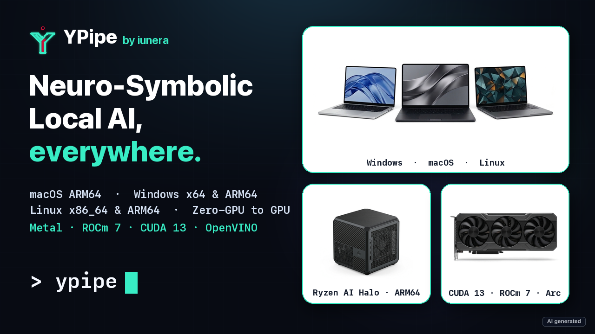

# YPipe — The Sovereign Local-First Neuro-Symbolic AI Platform

[](https://ypipe.com)
[](https://iunera.com)

<p align="center">
  
</p>

**[YPipe](https://ypipe.com) is the Sovereign Local-First Neuro-Symbolic AI Platform built for real data workflows, not just chat—with every model and MCP runtime bundled out of the box.** Compact local models often struggle with multi-step tool calling and strict policies on their own; wrapped in the **Neuro-Symbolic ypipe Manifold Engine**, compact `800M`–`32B` local models reliably execute structured workflows—autonomously chaining **MCP** tools, asking when required inputs are missing, keeping multi-turn sessions lightweight, and enforcing verifiable safety rules on standard CPUs and GPUs without a cloud API. Combine 1-click **MCP Couplings**, declarative **KnowledgePipes** RAG over private documents and live SQL, and visual multi-modal **SmartPipes** (speech, Vision OCR, image generation), then publish them in one click as web forms or REST webhooks—100% inside your own hardware boundary.

> **Note:** YPipe is the successor to **Data-Philter**. The legacy Data-Philter documentation and codebase are archived in [archive/data-philter/README.md](archive/data-philter/README.md).

---

## Quick Start & Download (Community Edition)

### Quick Start with JBang (Community Edition · Zero Setup)
Run the YPipe Community Edition instantly without manual installation using JBang:

```bash
jbang --fresh ypipe@iunera/ypipe
```

### Download Desktop Client — Community Edition
Grab the free Community Edition binaries for your OS at **[ypipe.com](https://ypipe.com)** or download them directly from **[GitHub Releases](https://github.com/iunera/ypipe/releases)** *(for Enterprise Edition & custom rollouts, [contact our architecture team](#skip-the-learning-curve))*:

<!-- TODO: Temporary download links pointing to Hetzner Object Storage (due to GitHub's 2 GiB release asset limit). Will be adjusted later. -->
*   **Windows:** [Installer (.exe — x64 / amd64)](https://ypiperesources.fsn1.your-objectstorage.com/releases/Windows/2.0.0/ypipe-2.0.0-windows-x64.exe) | [AppImage (.zip — x64 / amd64)](https://ypiperesources.fsn1.your-objectstorage.com/releases/Windows/2.0.0/ypipe-2.0.0-windows-x64.zip)
*   **macOS:** [Disk Image (.dmg — Apple Silicon)](https://ypiperesources.fsn1.your-objectstorage.com/releases/macOS/2.0.0/ypipe-2.0.0-macos-arm64.dmg)
*   **Linux:** [Package (.tar.gz — amd64 / x64)](https://ypiperesources.fsn1.your-objectstorage.com/releases/Linux/2.0.0/ypipe-2.0.0-linux-x64.tar.gz) | [Package (.tar.gz — arm64)](https://ypiperesources.fsn1.your-objectstorage.com/releases/Linux/2.0.0/ypipe-2.0.0-linux-arm64.tar.gz) | [Ubuntu (.deb — amd64)](https://ypiperesources.fsn1.your-objectstorage.com/releases/Linux/2.0.0/ypipe_2.0.0_amd64.deb) | [Ubuntu (.deb — arm64)](https://ypiperesources.fsn1.your-objectstorage.com/releases/Linux/2.0.0/ypipe_2.0.0_arm64.deb)
*   **Any (Java):** [Executable (.jar — Cross-Platform)](https://ypiperesources.fsn1.your-objectstorage.com/releases/Jar/2.0.0/ypipe-2.0.0.jar)

---

## Democratizing Enterprise-Grade Local AI.

We believe local AI should be accessible, secure, and easy to use. YPipe brings the power of offline models directly to your local and on-premise hardware—enabling every business to orchestrate private agentic workflows, securely dock with legacy systems and databases, and execute complex automations with absolute data sovereignty.

<p align="center">
  <a href="https://youtu.be/w5pob6jJ8N0">
    
  </a>
  <br>
  <em>Click to watch the YPipe Platform Overview on YouTube</em>
</p>

* **[Platform Overview — YPipe Sovereign Local-First AI Platform](https://youtu.be/w5pob6jJ8N0)**
* **[Neuro-Symbolic Local AI, Everywhere — Supported Hardware & OS Showcase](https://youtu.be/4ndYaeDWuas)**
* **[ypipe Manifold Engine — 800M Qwen 3.5 Tool Calling & Safety Guardrails](https://youtu.be/PCb2k9RXb0I)**
* **[SmartPipes Workflows — Visual Multi-Model Pipelines (Whisper, Vision OCR & Webhooks)](https://youtu.be/HbvZdx6Jq7g)**
* **[KnowledgePipes RAG — Declarative Local & On-Premise RAG (Vector DBs & Zero-ETL SQL)](https://youtu.be/ivY_E26wqwA)**

---

## Inside the Platform

Uniting **Neuro-Symbolic AI** with the **ypipe Manifold Engine**, multi-modal **SmartPipes**, local **KnowledgePipes RAG**, 1-click **MCP Couplings**, and bundled runtimes in the **Engine Foundry**—all in one sovereign client at **[ypipe.com](https://ypipe.com)**.

### 1. Chat & Neuro-Symbolic ypipe Manifold Engine
Powered by **Neuro-Symbolic AI**, the **ypipe Manifold Engine** takes the lead over compact local models (starting at 800M parameters) so standard Intel Core, AMD Ryzen, and Apple Silicon laptops execute complex multi-step tool chains and domain guardrails deterministically.

*   **Autonomous Chained Multi-Step Tool Calling:** Unlocks reliable MCP tool calling and autonomous multi-step chaining at the 800M scale—discovering database schemas and chaining consecutive SQL queries or diagnostics in a single turn.
*   **Safe Abstention & Grounded Answers:** Prevents silent parameter guessing when required inputs are missing and keeps responses aligned with verified data and tool outputs.
*   **Consistent Multi-Turn Memory:** Preserves domain facts and active rules reliably across long sessions with a low memory footprint on standard laptops.
*   **Explainable Safety & Policy Guardrails:** Enforce WHO ATC clinical contraindications, cumulative posology limits, and multi-criteria enterprise policies with step-by-step reasoning traces.
*   **Live Conversational Rule Learning:** Teach YPipe operational rules in plain English directly in chat; the Manifold Engine extracts, deduplicates, and enforces them immediately.
*   **Auto-Gear Hardware Optimization:** Inspects CPU, RAM, and GPU topology to recommend and switch between fast compact models and deep reasoning models automatically.

### 2. SmartPipes Multi-Model Workflows
Visually chain local speech-to-text (STT), text-to-speech (TTS), image recognition & Vision OCR, image generation, compact LLMs, JavaScript validators, and KnowledgePipes RAG sinks—with one-click publishing.

*   **Build Once → Publish:** Ground workflow steps with **KnowledgePipes RAG** and define your inputs once to instantly expose a **Human Web Form**, a **Production REST API Webhook (cURL)**, and a callable **MCP Tool**.
*   **STT, TTS, Image Recognition & Image Generation:** Capture live microphone or meeting audio for **Speech-to-Text (STT)**, synthesize natural voices via **Text-to-Speech (TTS)**, extract structured JSON via **Image Recognition & Vision OCR**, and run local **Image Generation** (Stable Diffusion)—all 100% offline.
*   **Tamper-Evident Execution Audit Trail:** Cryptographically chained execution history capturing prompts, step outputs, tool calls, and media artifacts for compliance verification.
*   **14+ Built-In Workflow Blueprints:** Fork ready-to-run templates for meeting transcription, receipt scanning, clinical dictation, and database health monitoring in one click.

### 3. KnowledgePipes Declarative RAG
A clean, composable three-layer RAG architecture separating database credentials (**KnowledgePipe Store**), scoped retrieval boundaries (**KnowledgePipe Context**), and document chunking (**KnowledgePipe Asset**).

*   **Embedded H2, PostgreSQL `pgvector` & MariaDB Vector:** Start with zero-config local H2 vector storage or scale to enterprise PostgreSQL (`pgvector`) and MariaDB 11.7+ `VECTOR` stores on-premise.
*   **Zero-ETL Read-Only Relational SQL Stores:** Query live MariaDB and PostgreSQL tables with parameterized SQL joins and autocomplete—zero vector duplication or sync delay.
*   **Strict Parameter Scope Pinning:** Lock filter parameters (like `patient_id` or `department`) inside a **KnowledgePipe Context** so unauthorized records never enter the prompt.
*   **Continuous SmartPipe RAG Sinks:** Automatically chunk, embed, and index new meeting transcripts or ward-round notes into your KnowledgePipe Store at the end of every workflow.

### 4. Two-Part MCP Couplings Solution
YPipe solves both halves of the Model Context Protocol challenge: zero-configuration runtimes for business users, and deterministic tool governance for compact local models.

*   **1. Bundled Node.js, Python (`uv`) & JBang Runtimes:** Install 17+ MCP blueprints (SQLite, PostgreSQL, MariaDB, ClickHouse, chDB, Apache Druid, Gmail, Custom Email, GitHub, Filesystem, Brave) with zero terminal setup.
*   **2. Fine-Grained Tool Control & Description Tuning:** Disable unneeded tools, rename operations, and refine tool descriptions visually so compact models never get lost in noisy schemas.
*   **Declarative K8s-Style `.ypipe` YAML Manifests:** Every MCP Coupling, SmartPipe, KnowledgePipe, and Model is stored as a clean `.ypipe` YAML manifest ready for GitOps and headless servers.

### 5. Engine Foundry & Runtimes
Manage 21+ curated local models and 8 self-contained native inference runtimes (`llama.cpp`, `whisper.cpp`, `stable-diffusion.cpp`, `sherpa-onnx`) with zero external dependencies.

*   **Runs on Everyday CPUs & GPUs:** Optimized native runtimes for Intel Core (AVX2), AMD Ryzen & Radeon (Vulkan/ROCm), NVIDIA CUDA, and Apple Silicon (Metal).
*   **Multi-Modal Model Catalog:** Filter and download Text LLMs, Vision-Language Models (VLMs), Whisper STT, Piper/VITS TTS, Stable Diffusion, and Embedding models in one click.
*   **Desktop, Web Mode & Headless Parity:** Run natively in the macOS/Windows/Linux desktop app, open the full multi-tab browser UI on `localhost:3000`, or deploy headlessly via Docker.

---

## Built for Real-World Operations

Everything else you need to take local AI from a laptop desktop client to a sovereign, production-ready enterprise platform.

*   **UI Mode, Headless & Web Mode:** Run YPipe natively in **UI Mode** on Windows, macOS, and Linux, open the full multi-tab workspace in your browser via **Web Mode** (`localhost:3000`), or deploy it as a **Headless** server background service and Docker container with full enterprise logging and plausibility checks.
*   **Zero-Setup Portability & Bundled Runtimes:** Just download and go—no hassle with inference engines or MCP servers, and no need to manage Python, Java, or Node.js environments. Self-contained native runtimes (`llama.cpp`, `whisper.cpp`, `stable-diffusion.cpp`, `sherpa-onnx`) and **Node.js, Python (`uv`), and Java (`JBang`)** are bundled out of the box.
*   **Auto-Gear & Intelligent Model Switchboard:** Don't force a massive, slow model to do a simple task. YPipe acts as an intelligent switchboard where **Auto-Gear** matches each job—Vision OCR on CPU, Whisper speech transcription, SQL generation, or synthesis—to the fastest compact local model, saving compute and latency.
*   **Visual Prototyping to GitOps (`.ypipe` YAML):** Bridge business domain experts and IT/DevOps. Business users design and test workflows visually on desktop or Web Mode, while every resource serializes to declarative Kubernetes-style **`.ypipe` YAML** manifests for Git versioning and automated deployment.
*   **Free, Enterprise Java & Cross-Platform:** No fragile Python dependency hell—built on rock-solid **Enterprise Java** that fits right into corporate IT setups. Completely free to download and run across Windows, macOS, Linux, or any JVM with curated models ready out of the box.
*   **EU AI Act Article 12 Tamper-Evident Audit Trail:** Cryptographically chained execution logs, untruncated run histories, and configurable retention policies provide verifiable plausibility and compliance—ready for regulated healthcare, finance, public sector, and industrial environments.

---

## Supported Hardware & OS — Neuro-Symbolic Local AI, Everywhere

YPipe ships self-contained native inference engines (`llama.cpp`, `whisper.cpp`, `stable-diffusion.cpp`, `sherpa-onnx`) and bundled **Node.js, Python (`uv`), and Java (`JBang`)** MCP runtimes across every major operating system and architecture—scaling from **800M zero-GPU business laptops** up to multi-GPU workstations via **Auto-Gear**.

<p align="center">
  <a href="https://youtu.be/4ndYaeDWuas">
    
  </a>
  <br>
  <em>Click to watch YPipe — Neuro-Symbolic Local AI, Everywhere (Hardware &amp; OS Showcase) on YouTube</em>
</p>

<!-- TODO: Temporary download links pointing to Hetzner Object Storage (due to GitHub's 2 GiB release asset limit). Will be adjusted later. -->
| Platform & Architecture | Native Runtime Target | Supported Hardware & Acceleration |
| :--- | :--- | :--- |
| **macOS · Apple Silicon** | `macos-arm64` | MacBook Air, MacBook Pro & Mac Studio — native **Apple Silicon Metal** ([`.dmg`](https://ypiperesources.fsn1.your-objectstorage.com/releases/macOS/2.0.0/ypipe-2.0.0-macos-arm64.dmg)) |
| **Windows 11 · x64** | `windows-x64` | Everyday business laptops (**800M Zero-GPU / AVX2**) up to workstation GPUs (**Vulkan**, **OpenVINO**, **CUDA 12/13**, **ROCm 7**, **SYCL**) ([`.exe`](https://ypiperesources.fsn1.your-objectstorage.com/releases/Windows/2.0.0/ypipe-2.0.0-windows-x64.exe), [`.zip`](https://ypiperesources.fsn1.your-objectstorage.com/releases/Windows/2.0.0/ypipe-2.0.0-windows-x64.zip)) |
| **Windows 11 · ARM64** | `windows-arm64` | **Snapdragon X Elite** Copilot+ laptops (**Adreno OpenCL** & **Vulkan**) |
| **Linux · x86_64** | `linux-x86_64` | Ubuntu, Debian & RHEL laptops, workstations & servers (**CPU/AVX2**, **Vulkan**, **OpenVINO**, **CUDA 12.8/13.4**, **ROCm 7**) ([`.deb`](https://ypiperesources.fsn1.your-objectstorage.com/releases/Linux/2.0.0/ypipe_2.0.0_amd64.deb), [`.tar.gz`](https://ypiperesources.fsn1.your-objectstorage.com/releases/Linux/2.0.0/ypipe-2.0.0-linux-x64.tar.gz), `Docker`) |
| **Linux · ARM64** | `linux-arm64` | ARM64 workstations, cloud instances & edge nodes (**CPU**, **Vulkan**, **CUDA 13.4**, **Snapdragon**) ([`.deb`](https://ypiperesources.fsn1.your-objectstorage.com/releases/Linux/2.0.0/ypipe_2.0.0_arm64.deb), [`.tar.gz`](https://ypiperesources.fsn1.your-objectstorage.com/releases/Linux/2.0.0/ypipe-2.0.0-linux-arm64.tar.gz), `Docker`) |
| **Dedicated GPUs & NPUs** | `Auto-Gear` | **AMD Ryzen AI Max+ Halo** (`gfx1151`) & **Radeon RX** (`ROCm 7` / `Vulkan`), **NVIDIA RTX** (`CUDA 12 & 13`), **Intel Core Ultra & Arc** (`OpenVINO` / `SYCL`) |

---

## Documentation & What's New

*   **[Release Changelog (`CHANGELOG.md`)](../CHANGELOG.md)** — Stay up to date with the latest features, improvements, and fixes from our active release stream.
*   **[How-To Guides Index](docs/howtos.md)** — Step-by-step guides for models, MCP couplings, and workflows.
*   **[KnowledgePipes Architecture & User Guide](docs/knowledgepipes-overview.md)** — Deep dive into Stores, Contexts, and Assets.
*   **[Headless & Server Deployment Guide](docs/HEADLESS.md)** — Running YPipe headlessly via CLI, systemd, Docker, and Kubernetes.

---

## Skip the Learning Curve

Move beyond generic chatbots and bring sovereign **Local AI** into your core business operations. Our **Local AI & MCP Architecture Team** at **[iunera](https://www.iunera.com)** helps you size hardware, tune compact models, and dock your enterprise data and functions via hardened **[Enterprise MCP Servers](https://www.iunera.com/enterprise-mcp-server-development/)**:

*   **Tailored Local AI Rollout:** We match the right compact local models to your existing CPUs and GPUs, engineer Neuro-Symbolic Manifold rules, and set up headless or on-premise YPipe deployments.
*   **Custom Enterprise MCP Servers:** We design and build production-hardened [MCP servers](https://www.iunera.com/enterprise-mcp-server-development/)—with SSO/OAuth 2.0, permission checks, and enterprise semantics—so local AI agents safely execute business functions.
*   **Legacy & Big Data Integration:** We bridge YPipe and KnowledgePipes RAG with your internal SQL databases, SAP, Apache Druid time-series clusters, and private document silos—100% GDPR-compliant and offline.

**[Talk to Our Local AI Architects (`contact@iunera.com`)](mailto:contact@iunera.com)** | **[Visit iunera.com →](https://www.iunera.com/)**

---

## You Know Our Tech From

YPipe is developed and maintained by **[iunera](https://www.iunera.com)**, the team behind industry-recognized platforms and projects:

*   **[Druid MCP Server](https://github.com/iunera/druid-mcp-server):** Intelligent Apache Druid management through natural language.
*   **[Fahrbar20](https://www.iunera.com/kraken/big-data-examples/how-nfts-and-ai-can-solve-public-transport-challenges/):** NFTs and AI solving public transport challenges.
*   **[Tracking, Prediction and Analytics](https://www.iunera.com/kraken/big-data-examples/third-party-data-geotracking-coronavirus/):** Insights from Covid pandemic tracking apps.
*   **[AI Social Altcoin Analytics](https://www.youtube.com/watch?v=4tv_L7W76b8):** AI-powered altcoin trends and tweetbot.
*   **[AI Analytics of German Federal Election](https://www.iunera.com/kraken/projects/baden-tv-interview-dr-frey-bundestagswahlanalyse/):** In-depth election analysis powered by AI.
*   **[License-Token](https://www.license-token.com/):** Secure open-source funding through AI and NFTs.

---

## Terms of Use & Proprietary Status

**YPipe** is currently released as an **Exclusive Technical Preview**.

*   **Free for Use:** You are free to download, run, and integrate YPipe into your personal or enterprise workflows during this preview period.
*   **Proprietary Rights:** All rights, title, and interest in and to the software (including the **ypipe Manifold Engine** and underlying orchestration architecture) remain the exclusive property of **iunera** and the respective developers.
*   **Restrictions:** Redistribution, modification, or decompilation of the YPipe binaries is strictly prohibited without express written consent from iunera.
*   **Future Licensing:** iunera reserves the right to introduce commercial licensing tiers or modified terms of use as the project evolves toward full production release.

For custom licensing or white-label integration requests, please **[Contact our Architectural Team](mailto:contact@iunera.com)**.

<p align="left">
  
</p>

© 2026 YPipe by iunera. All Rights Reserved.
[Imprint](https://iunera.com/imprint/) | [Privacy Policy](https://iunera.com/privacy-policy/) | [Cookie Policy](https://iunera.com/cookie-policy/)
