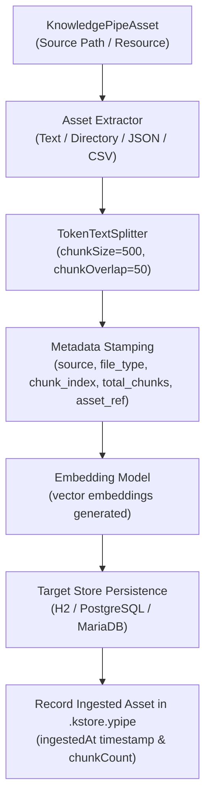

# KnowledgePipe Assets & Ingestion Pipelines

A **`KnowledgePipeAsset`** (`.kasset.ypipe`) declares a raw data source that can be parsed, chunked, and ingested into any configured `KnowledgePipeStore`.

---

## 1. Supported Asset Types

| Asset Type (`spec.assetType`) | Supported File Formats | Processing & Chunking Behavior |
|---|---|---|
| **`DOCUMENT`** | `.md`, `.adoc`, `.txt`, `.pdf`, `.docx`, `.html` | Full text extraction followed by token chunking with configurable `chunkSize` and `chunkOverlap`. |
| **`DIRECTORY_FILES`** | Any directory containing allowed document files | Recursive directory scan; extracts each matching file into individual document chunks. |
| **`PRE_CHUNKED_JSON`** | `.json`, `.jsonl` | Parses pre-split chunks (from JSON array or JSON Lines); normalizes raw identifiers into deterministic RFC-4122 UUIDs. |
| **`CSV`** | `.csv` | Reads tabular rows; converts each row into a structured document text representation while preserving column metadata. |

---

## 2. Ingestion Process & Chunking



### Metadata Stamping
During extraction and chunking, the ingestion service automatically stamps standard metadata keys onto each chunk:
- `source`: Filename or source identifier (e.g. `meeting-notes-2026-q3-sync.md`).
- `file_type`: Extension without leading dot (e.g. `md`, `pdf`, `docx`, `csv`).
- `chunk_index`: 0-indexed integer of the chunk within the document.
- `total_chunks`: Total number of chunks produced from the document.
- `asset_ref`: Qualified asset identifier (e.g. `default/documentation-files`).
- `asset_type`: Asset type string (`DOCUMENT`, `DIRECTORY_FILES`, `PRE_CHUNKED_JSON`, `CSV`).

---

## 3. Manifest Examples by Asset Type

### 3.1. Single Document Asset (`DOCUMENT`)

```yaml
apiVersion: rag.ypipe.com/v1
kind: KnowledgePipeAsset
metadata:
  name: platform-whitepaper
  namespace: default
spec:
  displayName: "Platform Architecture Whitepaper"
  description: "Official YPipe architecture specifications and whitepaper"
  assetType: DOCUMENT
  sourcePath: "classpath:ypipe/rag/samples/docs/meeting-notes-2026-q3-sync.md"
  chunkSize: 500
  chunkOverlap: 50
```

> [!NOTE]
> `sourcePath` supports both classpath resources (`classpath:path/to/file.md`), absolute filesystem paths (`/var/data/manuals/guide.pdf`), and workspace-relative paths (`repos/default/docs/notes.docx`).

---

### 3.2. Directory Asset (`DIRECTORY_FILES`)

```yaml
apiVersion: rag.ypipe.com/v1
kind: KnowledgePipeAsset
metadata:
  name: technical-handbooks-dir
  namespace: default
spec:
  displayName: "Technical Handbooks Directory"
  description: "Recursive ingestion of engineering handbooks and operational manuals"
  assetType: DIRECTORY_FILES
  sourcePath: "/Users/chris/git/docs/handbooks"
  allowedFileTypes:
    - md
    - adoc
    - pdf
    - docx
    - txt
  chunkSize: 400
  chunkOverlap: 40
```

---

### 3.3. Pre-Chunked JSON Asset (`PRE_CHUNKED_JSON`)

Pre-chunked datasets provide pre-computed text chunks and custom domain metadata:

```json
[
  {
    "chunk_id": "api-auth-bearer-token",
    "content": "All HTTP requests to the YPipe API require a Bearer token passed in the Authorization header.",
    "category": "SECURITY",
    "version": "v1.4"
  },
  {
    "chunk_id": "api-rate-limits",
    "content": "API requests are capped at 120 calls per minute per client tenant.",
    "category": "OPERATIONS",
    "version": "v1.4"
  }
]
```

Manifest:
```yaml
apiVersion: rag.ypipe.com/v1
kind: KnowledgePipeAsset
metadata:
  name: api-faq-prechunked
  namespace: default
spec:
  displayName: "API FAQ Pre-Chunked Dataset"
  description: "Structured FAQ knowledge chunks with pre-assigned categories"
  assetType: PRE_CHUNKED_JSON
  sourcePath: "classpath:ypipe/rag/samples/data/faq-chunks.json"
```

> [!TIP]
> **Deterministic RFC-4122 UUID Normalization:** If a `chunk_id` in the JSON is not already a valid RFC-4122 UUID (e.g. `api-auth-bearer-token`), `JsonChunkExtractor` generates a deterministic Name-based UUID (UUID v3/v5) from the UTF-8 bytes of the slug, ensuring idempotent ingestion across database engines.

---

### 3.4. Tabular CSV Asset (`CSV`)

```yaml
apiVersion: rag.ypipe.com/v1
kind: KnowledgePipeAsset
metadata:
  name: hardware-catalog-csv
  namespace: default
spec:
  displayName: "Hardware Catalog CSV"
  description: "Product inventory with model numbers, specifications, and pricing"
  assetType: CSV
  sourcePath: "/data/catalogs/hardware-inventory.csv"
```

Each row is formatted as key-value pairs (e.g., `sku: SRV-101 | name: High-Memory Server | ram: 512GB`) and embedded as an individual document chunk.

---

## 4. Ingestion REST Endpoints

### 4.1. Trigger Ingestion via REST (`POST /v1/knowledgepipes/stores/{ns}/{name}/ingest`)

```bash
curl -X POST "http://localhost:12000/v1/knowledgepipes/stores/default/corporate-pgvector-store/ingest" \
  -H "Content-Type: application/json" \
  -d '{"assetRef": "default/platform-whitepaper"}'
```

**Response:**
```json
{
  "status": "SUCCESS",
  "storeRef": "default/corporate-pgvector-store",
  "assetRef": "default/platform-whitepaper",
  "chunkCount": 18
}
```

### 4.2. Streaming Real-Time Progress (`GET /v1/knowledgepipes/stores/{ns}/{name}/ingest/stream`)

Streams Server-Sent Events (SSE) detailing each step of the ingestion process:

```bash
curl -N "http://localhost:12000/v1/knowledgepipes/stores/default/corporate-pgvector-store/ingest/stream?assetRef=default/technical-handbooks-dir"
```

**Stream Event Output:**
```
event: progress
data: {"step":"SCANNING","message":"Found 12 matching documents in directory..."}

event: progress
data: {"step":"CHUNKING","message":"Parsed handbook-auth.pdf into 34 token chunks"}

event: progress
data: {"step":"EMBEDDING","message":"Generated 34 embeddings with nomic-embed-text"}

event: complete
data: {"status":"SUCCESS","totalChunks":142}
```
