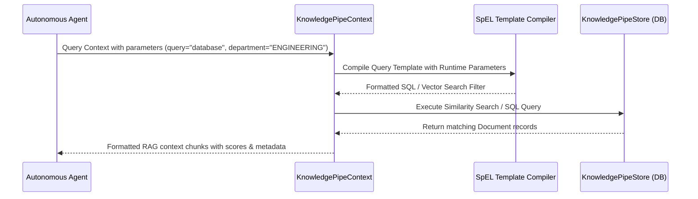

# KnowledgePipe Contexts & Semantic Retrieval

A **`KnowledgePipeContext`** (`.kcontext.ypipe`) defines a parameterized semantic retrieval surface that bridges AI agents with a `KnowledgePipeStore`.

---

## 1. Role in the Retrieval Pipeline

While a `KnowledgePipeStore` defines physical connection credentials and tables, the `KnowledgePipeContext` defines:
- The **parameter schema** exposed to agentic workflows (e.g. query string, filters, department, category).
- The **dynamic parameter bindings** and SpEL expression compilation.
- Value **auto-suggestions** for interactive UI components and agent discovery.
- Default fallback parameter values and query templates.



---

## 2. Manifest Specification

```yaml
apiVersion: rag.ypipe.com/v1
kind: KnowledgePipeContext
metadata:
  name: corporate-engineering-knowledge
  namespace: default
spec:
  displayName: "Engineering Architecture Context"
  description: "Semantic RAG search across engineering design docs, RFCs, and runbooks"
  storeRef: default/corporate-pgvector-store
  retrievalQueryTemplate: "SELECT id, content, metadata, 1 - (embedding <=> :query_vector) AS score FROM ${schemaName}.${tableName} WHERE metadata->>'department' = '${department}' ORDER BY embedding <=> :query_vector LIMIT 5"
  scopeParameters:
    department: "ENGINEERING"
    minScore: 0.75
  filterSchema:
    department:
      type: string
      displayName: "Engineering Sub-team"
      description: "Department filter applied during similarity search"
      enableSuggest: true
      suggestQuery: "ENGINEERING|INFRASTRUCTURE|SECURITY|DATA_PLATFORM"
    minScore:
      type: number
      displayName: "Minimum Relevance Score"
      description: "Cosine similarity threshold between 0.0 and 1.0"
```

---

## 3. SpEL Parameter Evaluation & Binding

When a query is dispatched to a context, the `ContextPayloadCompiler` evaluates SpEL placeholders (`${...}`) against the supplied parameter map. Parameters configured in `spec.scopeParameters` scope the context to the underlying store; they are immutable at runtime and strictly lock down the query parameters so consuming entities cannot override them:

1. **SQL String Escaping:** Dynamic text parameters injected into `${param}` are safely escaped to prevent SQL injection.
2. **Metadata Path Interpolation:** In PostgreSQL / MariaDB templates, parameters can be bound to JSON extraction operators (e.g. `metadata->>'department' = '${department}'` or `JSON_EXTRACT(metadata, '$.category') = '${category}'`).
3. **Empty Filter Handling:** Queries can use conditional logic like `('${department}' == '' OR metadata->>'department' = '${department}')` to allow optional parameter filtering.

---

## 4. Suggestions API (`/v1/knowledgepipes/contexts/{ns}/{name}/suggest`)

When `enableSuggest: true` is configured on a filter schema field, agents or UI components can query available parameter options:

```bash
curl "http://localhost:12000/v1/knowledgepipes/contexts/default/corporate-engineering-knowledge/suggest?field=department&q=sec"
```

**Response:**
```json
[
  "SECURITY"
]
```

Suggestions support:
- **Pipe-separated static literals**: e.g., `"ENGINEERING|INFRASTRUCTURE|SECURITY|DATA_PLATFORM"`
- **Live SQL query evaluation**: e.g., `"SELECT DISTINCT category FROM knowledge_docs"`

---

## 5. Querying a Context via REST (`POST /v1/knowledgepipes/contexts/{ns}/{name}/query`)

```bash
curl -X POST "http://localhost:12000/v1/knowledgepipes/contexts/default/corporate-engineering-knowledge/query" \
  -H "Content-Type: application/json" \
  -d '{
    "query": "How are JWT bearer tokens verified in the gateway?",
    "parameters": {
      "department": "SECURITY"
    },
    "topK": 3
  }'
```

**Response:**
```json
{
  "contextRef": "default/corporate-engineering-knowledge",
  "storeRef": "default/corporate-pgvector-store",
  "documents": [
    {
      "id": "e4b2d3c1-4567-4890-a123-456789abcdef",
      "text": "The API gateway validates RSA-256 JWT tokens using the public key hosted at /.well-known/jwks.json.",
      "metadata": {
        "source": "api-gateway-security-rfc.md",
        "department": "SECURITY",
        "chunk_index": 2,
        "score": 0.912
      }
    }
  ]
}
```
