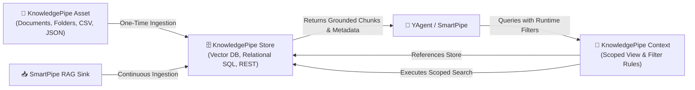

# KnowledgePipes Subsystem Overview

The **KnowledgePipes** subsystem in YPipe provides local Retrieval-Augmented Generation (RAG) and structured enterprise data grounding for autonomous **YAgents** and visual **SmartPipes** workflows.

Instead of coupling document files, database tables, and agent access rules into a single monolithic configuration, KnowledgePipes separates your knowledge pipeline into three reusable building blocks: **Stores**, **Assets**, and **Contexts**.

---

## 1. The Three Pillars: Store, Asset, and Context

| Building Block | Core Purpose | How You Use It |
|---|---|---|
| **Store** | **Where & How Data Lives.** Configures the physical storage engine, embedding model, table/schema target, and the parameter schema (metadata fields or columns) used for ingestion and filtering. | Configure your local **Embedded H2**, **PostgreSQL**, **MariaDB**, or **REST** connection; test connectivity; ingest Assets; and verify queries in the built-in Store Sandboxes. |
| **Asset** | **What Data Gets Ingested.** Points to raw documents (`.md`, `.pdf`, `.docx`, `.txt`, `.html`), folders, tabular CSVs, or pre-chunked JSON datasets along with token-chunking rules and static metadata tags. | Register your files or directories once, then ingest them into one or more Vector Stores with live streaming progress and automatic metadata stamping. |
| **Context** | **Who Sees What (The Retrieval Lens).** Creates a curated, scoped access boundary on top of a Store that is handed to AI Agents and SmartPipes. | **Pin** filter parameters to fixed values (to isolate a Context to a specific department or topic) or leave them **dynamic** so callers can pass filter values at runtime. |

---

## 2. Storage Engines Supported by KnowledgePipe Stores

KnowledgePipes supports both **Vector RAG Stores** (for semantic meaning search and chunk ingestion) and **Structured / External Stores** (for read-only SQL or API lookups):

1. **Local Embedded Vector Store (`EMBEDDED_H2`):**
   Zero-configuration local vector database with automatic on-disk table persistence in H2. Ideal for out-of-the-box desktop execution and sovereign local workflows without external database dependencies.
   👉 *See [Embedded H2 Dynamic Vector Store](knowledgepipes-store-embedded-h2.md).*

2. **PostgreSQL `pgvector` & Relational Store (`PGVECTOR` / `POSTGRESQL_RELATIONAL`):**
   Enterprise vector storage using the `pgvector` extension and HNSW cosine similarity indexing, or direct read-only SQL querying against existing relational tables.
   👉 *See [PostgreSQL Store Integration](knowledgepipes-store-postgres.md).*

3. **MariaDB Vector & Relational Store (`MARIADB_VECTOR` / `MARIADB_RELATIONAL`):**
   Native MariaDB 11.7+ vector search with `VEC_DISTANCE_COSINE` indexing, or direct read-only relational SQL execution.
   👉 *See [MariaDB Store Integration](knowledgepipes-store-mariadb.md).*

4. **External REST Endpoint (`REST_PAYLOAD`):**
   Connects to external HTTP/JSON search APIs to retrieve structured or unstructured context dynamically at runtime.

---

## 3. Document Assets & Ingestion

KnowledgePipe Assets let you prepare four types of data sources for vector ingestion:
- **Single Document (`DOCUMENT`)**: Individual Markdown (`.md`), AsciiDoc (`.adoc`), Plaintext (`.txt`), PDF (`.pdf`), Word (`.docx`), or HTML files split into overlapping token chunks.
- **Directory of Files (`DIRECTORY_FILES`)**: Recursive directory scanning filtered by file extension (`md`, `pdf`, `docx`, `txt`, etc.).
- **Pre-Chunked JSON (`PRE_CHUNKED_JSON`)**: Pre-split JSON arrays or JSON Lines (`.jsonl`) with deterministic UUID normalization for idempotent re-ingestion.
- **Tabular CSV (`CSV`)**: Spreadsheets converted row-by-row into structured key-value text chunks with preserved column metadata.

In addition to one-time Asset ingestion in the Store UI, you can continuously stream pipeline outputs into any Vector Store using the **KnowledgePipe RAG Sink** step in **SmartPipes**.

👉 *See [Assets & Ingestion Pipelines](knowledgepipes-assets-and-ingestion.md).*

---

## 4. Scoped Contexts & Consumer Integration

Rather than exposing raw database tables to LLMs, you bind **KnowledgePipe Contexts** to your **YAgents** and **SmartPipes (`LLM Step`)**:
- **Fixed Scope Pinning**: Lock parameters (such as `department = ENGINEERING`) inside the Context so consuming agents can never bypass your data boundary.
- **Dynamic Runtime Filtering**: Leave selected parameters open so workflows and agents can pass runtime filter values (such as a user-selected category or date range).
- **Interactive Sandboxes**: Test both your raw Store queries and your scoped Context retrieval live in the UI before deploying your agents.

👉 *See [Contexts & Semantic Retrieval](knowledgepipes-contexts-and-retrieval.md).*
